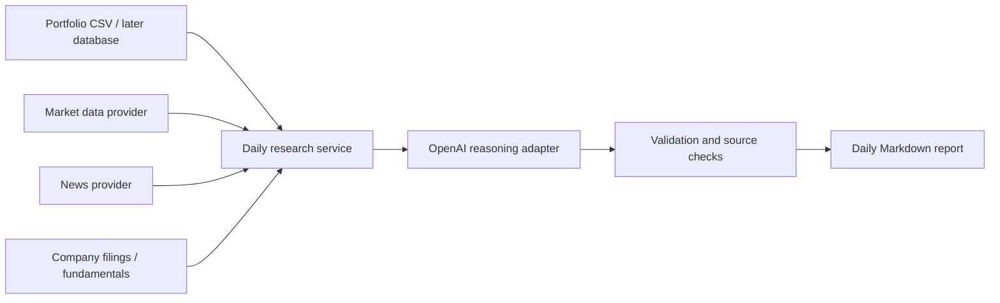

# Personal AI Investment Research Assistant

The [multi-company navigator](docs/multi-company-analysis.md) extends `/company`
with 7,625 sourced SEC candidate identities, ranked search, a mobile picker and
explicit durable preparation jobs. Directory coverage, stored analysis and template
support are counted separately. Browsing never calls market-data providers.

The integrated [single-company dashboard](docs/single-company-analysis.md) tracks
NVDA against SPY and XLK using stored Twelve Data, SEC and FRED inputs. Install
`python -m pip install -e ".[web,company]"`, configure the new `.env.example` fields,
run `investment-assistant company ingest --full`, then open `/company` in the existing
web workspace. Daily ingestion, SQLite backups and a gated 20-session ridge
evaluation are available without OpenAI calls.

Deterministic listed-equity market context is available without OpenAI calls:

```powershell
investment-assistant regime
investment-assistant regime --as-of 2024-05-17
investment-assistant analogues NVDA --top 10 --benchmark SPY
investment-assistant analogues SPCX --as-of 2026-10-30
investment-assistant analogue-case SPCX 2025-02-28
investment-assistant analogues SPCX --with-context
investment-assistant scenarios SPCX
investment-assistant scenarios SPCX --dry-run
```

The deterministic [Scenario Reasoning Engine](docs/scenario-reasoning-engine.md) provides conditional 20/60-session outlooks without OpenAI calls or personal-profile inputs.

Historical context now adds sourced event explanations, possible mechanisms and 20/60-session outcomes without OpenAI calls. See the [implementation report and three complete cases](docs/historical-context-engine.md).

See [market regimes](docs/market-regime.md) and [historical analogues](docs/historical-analogues.md)
for rules, evidence, limitations and configurable private artifact paths. The web
overview reads saved context; new listings use market-only comparisons when target
history is insufficient. Historical comparisons are not forecasts. Macro policy,
inflation and growth remain explicitly unknown in this version.

The guided local web workspace is available: install `python -m pip install -e ".[web]"`,
run `investment-assistant web`, and open <http://localhost:8000>. It includes optional
onboarding, daily charts, three report presets, profiles and private versioned annotations.
See [the web workspace guide](docs/web-workspace.md) for privacy, recovery and testing details.

This is a project that helps beginners build an investment research habit. It is not a stock-price predictor and does not directly give “buy” or “sell” instructions.

At the current stage, it does two things:

1. Designs an extensible system architecture.
2. Provides a basic Python project that can read sample holdings and check configuration.

When you run `investment-assistant`, it reads and prints the sample holdings. This is the current minimum working version: the input is a CSV file, and the output is a validated list of holdings.

## 1. Design Principles

- **Separate facts from opinions**: Prices, news, and financial figures come from financial data sources; the AI must not invent these facts.
- **Evidence first**: Every important conclusion should eventually retain its source, timestamp, and applicable company.
- **Make uncertainty visible**: Reports should distinguish between “known facts,” “reasonable inferences,” and “yet to be verified.”
- **Education rather than instructions**: The AI can raise questions, list scenarios, and present opposing views, but it does not make trading decisions for you.
- **Replaceable providers**: OpenAI and financial-data providers are kept in an adapter layer, so the core business logic does not depend on any single API.

## 2. System Architecture



The code is organized into four layers:

- `domain/`: Core data concepts in the project, such as holdings, news, and quotes.
- `ports/`: Capability interfaces required by the core business logic; contains no provider-specific code.
- `adapters/`: Concrete implementations for external systems such as CSV, OpenAI, and future financial APIs.
- `services/`: Connects “read holdings → collect facts → analyze with AI → generate report.”

The benefit of this layering is that when you switch news APIs later, you only need to change one adapter instead of rewriting the research logic.

## 3. Future Data Flow for the Daily Report

1. Read the holdings and identify securities explicitly using “exchange + ticker,” so that only stocks you actually follow are researched.
2. Retrieve timestamped quotes, relevant news, and company fundamentals.
3. Clean and deduplicate the data, linking every fact to its source.
4. Calculate deterministic metrics such as daily price changes and portfolio concentration.
5. Give the organized facts to OpenAI without allowing the model to guess numbers on its own.
6. Ask the model to explain possible causal chains, alternative explanations, risks, opportunities, and opposing questions.
7. Validate the company tickers and citations in the output, then generate the Markdown daily report.

## 4. Current Directory

```text
.
├── data/
│   └── portfolio.example.csv
├── src/investment_assistant/
│   ├── adapters/          # External service implementations
│   ├── domain/            # Core data structures
│   ├── ports/             # Replaceable interfaces
│   ├── services/          # Business workflows
│   ├── cli.py             # Command-line entry point
│   └── config.py          # Environment-variable configuration
├── tests/
├── .env.example
└── pyproject.toml
```

### Purpose of Each File

| File | Why it is needed |
| --- | --- |
| `.gitignore` | Prevents secrets, real holdings, virtual environments, and temporary files from entering version control. |
| `.env.example` | Shows which environment variables are required without storing real secrets. |
| `pyproject.toml` | Defines the project name, Python version, dependencies, test configuration, and command-line entry point. |
| `README.md` | The learning guide and project roadmap you are reading. |
| `data/portfolio.example.csv` | A safe sample input; later copy it to `portfolio.csv` and enter your own holdings. |
| `src/investment_assistant/__init__.py` | Declares the directory as a Python package and stores the project version. |
| `src/investment_assistant/__main__.py` | Supports starting the program with `python -m investment_assistant`. |
| `src/investment_assistant/cli.py` | Parses commands and displays results to the user; it is the current program entry point. |
| `src/investment_assistant/config.py` | Reads configuration from `.env` and ensures that secrets are not printed during diagnostics. |
| `domain/models.py` | Defines the standard shapes of holdings, prices, news, and fundamentals in the program. |
| `ports/providers.py` | Defines the capabilities the program needs without binding it to a specific financial-data provider. |
| `adapters/csv_portfolio.py` | Reads and validates the CSV, converting each row into a `Holding`. |
| `adapters/openai_reasoner.py` | A thin wrapper around the OpenAI Responses API; the current command does not call it. |
| `adapters/yfinance_market_data.py` | Retrieves daily data for one stock and calculates the daily change and five-trading-day change. |
| `adapters/news/gdelt.py` | Retrieves article metadata from the public GDELT DOC 2.0 API without downloading article bodies. |
| `adapters/news/google_news_rss.py` | Reads the public Google News RSS feed without accessing the target article bodies. |
| `adapters/news/subscription_placeholders.py` | Disabled placeholder adapters for FT and university news databases; they never connect without valid credentials and permission. |
| `services/daily_research.py` | Coordination skeleton for the next-stage daily-report workflow; currently it only describes how evidence is assembled. |
| `services/news_service.py` | Merges results from multiple sources, deduplicates them, scores them by rules, and selects the top 10. |
| `domain/news.py` | Defines article fields, source categories, and known company aliases. |
| `ports/news.py` | Defines the replaceable news-source interface and error boundaries such as no news and network failure. |
| Each directory’s `__init__.py` | Makes Python recognize these directories as packages and briefly describes each layer’s responsibility. |
| `tests/test_csv_portfolio.py` | Verifies that valid CSV files can be read and CSV files with missing columns are rejected. |
| `tests/test_yfinance_market_data.py` | Uses fake market data to test calculations and error handling without accessing the network. |
| `tests/test_stock_cli.py` | Tests whether the terminal stock report is clear and consistently formatted. |
| `tests/test_gdelt_news.py` | Uses local JSON to test public metadata parsing without accessing the internet. |
| `tests/test_google_news_rss.py` | Uses local XML to test RSS metadata parsing without accessing the internet. |
| `tests/test_news_service.py` | Tests deduplication, ranking, the top 10, empty results, and network failures. |
| `tests/test_news_cli.py` | Tests terminal news output and missing summaries. |
| `tests/test_subscription_news_adapters.py` | Verifies that subscription sources remain disabled and cannot be called accidentally. |

## 5. First Run

Run the following commands in PowerShell:

```powershell
python -m venv .venv
.\\.venv\\Scripts\\Activate.ps1
python -m pip install -e ".[dev]"
investment-assistant show-portfolio --file data/portfolio.example.csv
investment-assistant doctor
investment-assistant stock NVDA
investment-assistant news NVDA
pytest
```

After installation, the shortest first-run method is:

```powershell
investment-assistant
```

`show-portfolio` only reads local sample data and does not access the network. `doctor` only checks whether keys exist; it does not print key contents or call any API.

### Query a Stock

```powershell
investment-assistant stock NVDA
```

The program prints the latest available daily close, the previous trading day’s close, the daily percentage change, the five-trading-day percentage change, and volume. “Five days” means five trading days, not five calendar days. Prices come from the unadjusted `Close` column. This command only accesses Yahoo Finance; it does not call OpenAI or the news services.

The Phase 1.1 daily event-news report can first be safely previewed:

```powershell
investment-assistant news-report SPCX --dry-run
```

See `docs/daily-news-report.md` for detailed evidence limits, caching, and output guidance. Without `--dry-run`, the command calls the OpenAI Responses API and saves the result to `reports/YYYY-MM-DD/TICKER-news.md`.

Phase 2 deep analysis can first be run as a cost-free preview:

```powershell
investment-assistant analyse SPCX --deep --dry-run
```

See `docs/deep-analysis.md` for the deep-report structure and limitations. The full report is saved to `reports/YYYY-MM-DD/TICKER-deep.md`.

New deep reports use a compact nine-part structure with at most five key pieces of evidence, targeting an output below 3,500 tokens. The safe limit defaults to 6,000 tokens. You can lower it with `OPENAI_DEEP_MAX_OUTPUT_TOKENS`, but it cannot exceed 6,000.

Phase 3 private investor profiles can be created or edited through hidden input:

```powershell
investment-assistant profile SPCX
```

Profiles are stored in the Git-ignored `profiles/` directory. See `docs/investor-profile.md` for fields, JSON import, and privacy limitations.

Saved structured responses from deep analyses can be revalidated and reformatted completely offline:

```powershell
investment-assistant validate-report PATH
```

See `docs/report-recovery.md` for paid-response retention, rejected files, validation severity levels, and local repair instructions.

### Query Recent Company News

```powershell
investment-assistant news NVDA
```

The currently enabled sources are the public GDELT DOC 2.0 API and Google News RSS; neither requires an API key. Together they receive at most 20 article metadata records. If one source experiences a network failure, the program displays a warning and continues with the other source. Results are deduplicated by normalized URL and title, scored for relevance and potential financial importance using transparent rules, and the top 10 are displayed. Only the title, publisher, time, URL, source category, and summaries legally provided by the source are retained; article bodies are not downloaded or saved.

The FT API and university news database adapters are disabled by default. They are enabled separately only after you provide valid API credentials and explicitly confirm that your subscription or university license allows programmatic access. The program never logs in to subscription platforms automatically.

Source and licensing information:

- [GDELT DOC 2.0 API](https://blog.gdeltproject.org/gdelt-doc-2-0-api-debuts/amp/)
- [GDELT Terms of Use](https://www.gdeltproject.org/about.html)

When you need to connect services, copy the configuration template:

```powershell
Copy-Item .env.example .env
```

Then enter the real keys in `.env`. `.gitignore` prevents `.env` and your real holdings file from being committed.

## 6. Why a Real AI Daily Report Is Not Generated Yet

The daily report depends on three items that have not yet been jointly decided: the financial-data provider, your market scope (for example, US or UK stocks), and your report preferences. Implementing it too early would lock the project into incorrect assumptions. The current interfaces reserve the necessary positions for the next phase.

Suggested next steps:

1. Improve holdings management and input validation.
2. Choose a quotes/fundamentals API and implement the first adapter.
3. Add news collection, deduplication, and stock association.
4. Test OpenAI analysis with fixed samples before using real-time data.
5. Generate Markdown daily reports with sources and disclaimers.
6. Add daily automation only at the end.

## 7. OpenAI Integration Notes

`OpenAIReasoner` uses the Responses API from the OpenAI Python SDK. The model name is read from `OPENAI_MODEL`, avoiding hard-coded model names throughout the business code. The default selects a cost/capability-balanced model from the current official model family; you can switch it without changing code.

Official references:

- [OpenAI API quickstart](https://developers.openai.com/api/docs/quickstart)
- [Text generation guide](https://developers.openai.com/api/docs/guides/text)
- [Models](https://developers.openai.com/api/docs/models)

## 8. Important Limitations

This project is for learning and research only and does not constitute investment advice. AI may misunderstand news, miss information, or incorrectly infer causal relationships. Decisions involving real money should be based on the original announcements, regulatory filings, and your own risk tolerance.
