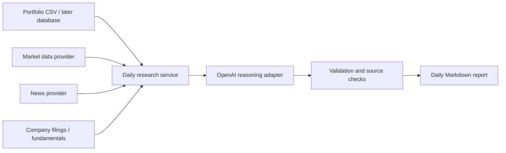

# Personal AI Investment Research Assistant

新增[多公司浏览层](docs/multi-company-analysis.md)：在原有 `/company` 页面增加
7,625 条来自 SEC 的候选证券记录、排序搜索、可独立滚动的列表和移动端选择器。
目录数量、已有分析数量和财务模板支持数量分别显示；准备/刷新通过持久队列显式执行，
浏览页面不会自动请求行情。

新增[单公司分析仪表盘](docs/single-company-analysis.md)：NVDA 对比 SPY、XLK，使用本地保存的
Twelve Data、SEC、FRED 数据。安装 `python -m pip install -e ".[web,company]"`，配置
`.env.example` 中的新字段，运行 `investment-assistant company ingest --full`，然后在原有
网页工作区打开 `/company`。支持每日采集、SQLite 备份及有验证门槛的 20 交易日回归实验，
无需调用 OpenAI。

新增确定性市场环境与历史类比引擎，不调用 OpenAI：

```powershell
investment-assistant regime
investment-assistant regime --as-of 2024-05-17
investment-assistant analogues NVDA --top 10 --benchmark SPY
investment-assistant analogues SPCX --as-of 2026-10-30
investment-assistant analogue-case SPCX 2025-02-28
investment-assistant analogues SPCX --with-context
investment-assistant scenarios SPCX
investment-assistant scenarios SPCX --dry-run
```

确定性的[情景推理引擎](docs/scenario-reasoning-engine.md)可生成 20/60 个交易日的条件情景，不调用 OpenAI，也不使用个人风险偏好或持仓资料。

历史背景引擎现已支持有来源的市场事件解释、可能的传导机制及 20/60 个交易日的后续表现，无需调用 OpenAI。详见[实现报告及三个完整案例](docs/historical-context-engine.md)。

规则与限制见 [市场环境说明](docs/market-regime.md) 和
[历史类比说明](docs/historical-analogues.md)。网页概览只读已保存的结果；新上市股票
历史不足时使用市场环境类比，不虚构个股历史。历史比较不是预测。货币政策、通胀与
增长在此版本中明确显示为 unknown。可用 `INVESTMENT_RESEARCH_ROOT` 配置私有保存位置。

现在可使用本地引导式研究网页：安装 `python -m pip install -e ".[web]"`，运行
`investment-assistant web`，然后打开 <http://localhost:8000>。支持首次问卷、行情图表、
三种报告、个人档案和私有批注；生成付费分析前会预览发送内容。
使用方法、数据保存和测试说明见 [网页工作区说明](docs/web-workspace.md)。

这是一个帮助初学者建立投资研究习惯的项目。它不是股价预测器，也不会直接给出“买入/卖出”指令。

当前阶段只完成两件事：

1. 设计可扩展的系统架构。
2. 创建能读取示例持仓、检查配置的 Python 基础项目。

运行 `investment-assistant` 时，它会读取示例持仓并打印出来。这就是当前的最小工作版本：输入是 CSV，输出是经过校验的持仓列表。

## 1. 设计原则

- **事实与观点分离**：价格、新闻、财报数字来自金融数据源；AI 不能编造这些事实。
- **证据优先**：未来每个重要结论都应保留来源、时间和适用公司。
- **不确定性可见**：报告应区分“已知事实”“合理推断”“尚待验证”。
- **教育而非指令**：AI 可以提出问题、列出情景和反方观点，但不替你作交易决定。
- **供应商可替换**：OpenAI 和金融数据供应商都放在适配器层，核心业务不依赖某一家 API。

## 2. 系统架构



代码按四层组织：

- `domain/`：项目中的核心数据概念，如持仓、新闻和报价。
- `ports/`：核心业务需要的能力接口，不包含任何供应商代码。
- `adapters/`：CSV、OpenAI、未来金融 API 等外部系统的具体实现。
- `services/`：把“读取持仓 → 收集事实 → AI 分析 → 生成报告”串起来。

这种分层的好处是：以后更换新闻 API 时，只改一个适配器，不必重写研究逻辑。

## 3. 每日报告的未来数据流

1. 读取持仓，用“交易所 + 股票代码”明确证券身份，只研究你实际关注的股票。
2. 拉取带时间戳的报价、相关新闻和公司基本面。
3. 清洗、去重，并把每条事实和来源绑定。
4. 计算确定性指标，例如单日涨跌和持仓集中度。
5. 把整理后的事实交给 OpenAI，不让模型自行猜数字。
6. 要求模型解释可能的因果链、替代解释、风险、机会和反方问题。
7. 校验输出中的公司代码和引用，再生成 Markdown 日报。

## 4. 当前目录

```text
.
├── data/
│   └── portfolio.example.csv
├── src/investment_assistant/
│   ├── adapters/          # 外部服务实现
│   ├── domain/            # 核心数据结构
│   ├── ports/             # 可替换接口
│   ├── services/          # 业务流程
│   ├── cli.py             # 命令行入口
│   └── config.py          # 环境变量配置
├── tests/
├── .env.example
└── pyproject.toml
```

### 每个文件的作用

| 文件 | 为什么需要它 |
| --- | --- |
| `.gitignore` | 防止密钥、真实持仓、虚拟环境和临时文件进入版本控制。 |
| `.env.example` | 展示需要哪些环境变量，但不保存真实密钥。 |
| `pyproject.toml` | 定义项目名称、Python 版本、依赖、测试配置和命令行入口。 |
| `README.md` | 你正在阅读的学习说明和项目路线图。 |
| `data/portfolio.example.csv` | 可安全运行的示例输入；以后复制为 `portfolio.csv` 填入自己的持仓。 |
| `src/investment_assistant/__init__.py` | 把目录声明为 Python 包，并保存项目版本号。 |
| `src/investment_assistant/__main__.py` | 支持用 `python -m investment_assistant` 启动程序。 |
| `src/investment_assistant/cli.py` | 解析命令并把结果显示给用户，是当前程序入口。 |
| `src/investment_assistant/config.py` | 从 `.env` 读取配置，并确保诊断时不打印密钥。 |
| `domain/models.py` | 定义持仓、价格、新闻和基本面在程序中的标准形状。 |
| `ports/providers.py` | 定义程序需要什么能力；暂不绑定具体金融数据供应商。 |
| `adapters/csv_portfolio.py` | 读取并校验 CSV，将每一行转换为 `Holding`。 |
| `adapters/openai_reasoner.py` | OpenAI Responses API 的薄封装；当前命令不会调用它。 |
| `adapters/yfinance_market_data.py` | 获取一只股票的日线数据，并计算日涨跌与 5 个交易日涨跌。 |
| `adapters/news/gdelt.py` | 从公开 GDELT DOC 2.0 API 获取文章元数据，不下载正文。 |
| `adapters/news/google_news_rss.py` | 读取公开 Google News RSS 项目，不访问目标文章正文。 |
| `adapters/news/subscription_placeholders.py` | FT 与大学新闻数据库的禁用占位适配器；没有合法凭证和许可时绝不联网。 |
| `services/daily_research.py` | 下一阶段日报流程的协调骨架，目前只描述证据如何汇集。 |
| `services/news_service.py` | 合并多来源结果，去重、规则评分并选出前 10 条。 |
| `domain/news.py` | 定义文章字段、来源类别和已知公司别名。 |
| `ports/news.py` | 定义可替换新闻来源接口，以及无新闻、网络失败等错误边界。 |
| 各目录的 `__init__.py` | 让 Python 识别这些目录为包，并用一句话说明该层职责。 |
| `tests/test_csv_portfolio.py` | 验证正确 CSV 可以读取、缺列 CSV 会被拒绝。 |
| `tests/test_yfinance_market_data.py` | 使用假行情测试计算和错误处理，不访问网络。 |
| `tests/test_stock_cli.py` | 测试终端行情报告是否清晰、格式是否稳定。 |
| `tests/test_gdelt_news.py` | 用本地 JSON 测试公开元数据解析，不访问互联网。 |
| `tests/test_google_news_rss.py` | 用本地 XML 测试 RSS 元数据解析，不访问互联网。 |
| `tests/test_news_service.py` | 测试去重、排名、前 10 条、空结果和网络失败。 |
| `tests/test_news_cli.py` | 测试新闻终端输出和缺失摘要。 |
| `tests/test_subscription_news_adapters.py` | 验证订阅来源保持禁用且不会被误调用。 |

## 5. 第一次运行

在 PowerShell 中依次执行：

```powershell
python -m venv .venv
.\.venv\Scripts\Activate.ps1
python -m pip install -e ".[dev]"
investment-assistant show-portfolio --file data/portfolio.example.csv
investment-assistant doctor
investment-assistant stock NVDA
investment-assistant news NVDA
pytest
```

安装完成后，最短的首次运行方式是：

```powershell
investment-assistant
```

`show-portfolio` 只读取本地示例数据，不访问网络。`doctor` 只检查密钥是否存在，不会打印密钥内容，也不会调用 API。

### 查询一只股票

```powershell
investment-assistant stock NVDA
```

程序会打印最新可用日线的收盘价、前一交易日收盘价、日涨跌幅、5 个交易日涨跌幅和成交量。这里的“5 日”指五个交易日，不是五个自然日。价格来自未复权的 `Close` 列。该命令只访问 Yahoo Finance，不会调用 OpenAI 或新闻服务。

Phase 1.1 的每日事件新闻报告可先安全预览：

```powershell
investment-assistant news-report SPCX --dry-run
```

详细的证据限制、缓存和输出说明见 `docs/daily-news-report.md`。不带 `--dry-run` 会调用
OpenAI Responses API，并将结果保存到 `reports/YYYY-MM-DD/TICKER-news.md`。

Phase 2 的深度分析可以先运行无费用预览：

```powershell
investment-assistant analyse SPCX --deep --dry-run
```

深度报告的结构和限制见 `docs/deep-analysis.md`。正式报告保存到
`reports/YYYY-MM-DD/TICKER-deep.md`。

新的深度报告使用紧凑的九部分结构，最多五条关键证据，目标输出低于 3,500 tokens。
安全上限默认为 6,000 tokens；可用 `OPENAI_DEEP_MAX_OUTPUT_TOKENS` 调低，但不能超过
6,000。

Phase 3 的私有投资者档案可通过隐藏输入创建或编辑：

```powershell
investment-assistant profile SPCX
```

档案保存在已被 Git 忽略的 `profiles/` 目录。字段、JSON 导入和隐私限制见
`docs/investor-profile.md`。

已保存的深度分析结构化响应可以完全离线重新验证和格式化：

```powershell
investment-assistant validate-report PATH
```

付费响应保留、rejected 文件、验证严重级别和本地修复说明见
`docs/report-recovery.md`。

### 查询近期公司新闻

```powershell
investment-assistant news NVDA
```

当前启用来源是公开的 GDELT DOC 2.0 API 和 Google News RSS，都不需要 API key。两者合计最多接收 20 条文章元数据；单个来源网络失败时，程序会显示警告并继续使用另一个来源。结果按规范化 URL 和标题去重，用透明规则计算相关性与潜在财务重要性，再显示前 10 条。只保留标题、发布者、时间、URL、来源类别和来源合法提供的摘要；不会下载或保存文章正文。

FT API 与大学新闻数据库适配器默认禁用。只有在你提供合法 API 凭证，并明确确认订阅或学校许可允许程序化访问后，才会单独启用。程序不会自动登录任何订阅平台。

来源与许可说明：

- [GDELT DOC 2.0 API](https://blog.gdeltproject.org/gdelt-doc-2-0-api-debuts/amp/)
- [GDELT 使用条款](https://www.gdeltproject.org/about.html)

等需要连接服务时，再复制配置模板：

```powershell
Copy-Item .env.example .env
```

然后把真实密钥填入 `.env`。`.gitignore` 已阻止 `.env` 和你的真实持仓文件被提交。

## 6. 为什么目前没有真正生成 AI 日报

日报依赖三个尚未共同决定的事项：金融数据供应商、你的市场范围（例如美股或英股），以及报告偏好。现在提前实现会把项目锁死在错误假设上。当前接口已经为下一阶段预留位置。

建议后续按以下小步推进：

1. 完善持仓管理和输入校验。
2. 选择一个报价/基本面 API，并实现第一个适配器。
3. 增加新闻收集、去重和股票关联。
4. 用固定样例测试 OpenAI 分析，不先使用实时数据。
5. 生成带来源和免责声明的 Markdown 日报。
6. 最后再加入每日自动运行。

## 7. OpenAI 接入说明

`OpenAIReasoner` 使用 OpenAI Python SDK 的 Responses API。模型名称从 `OPENAI_MODEL` 读取，避免散落在业务代码里。默认值选择当前官方模型系列中的成本/能力平衡档，你可以不改代码直接更换。

官方参考：

- [OpenAI API quickstart](https://developers.openai.com/api/docs/quickstart)
- [Text generation guide](https://developers.openai.com/api/docs/guides/text)
- [Models](https://developers.openai.com/api/docs/models)

## 8. 重要限制

本项目输出仅用于学习和研究，不构成投资建议。AI 可能误解新闻、遗漏信息或错误推断因果关系。涉及真实资金的决定应回到原始公告、监管文件和你自己的风险承受能力。
