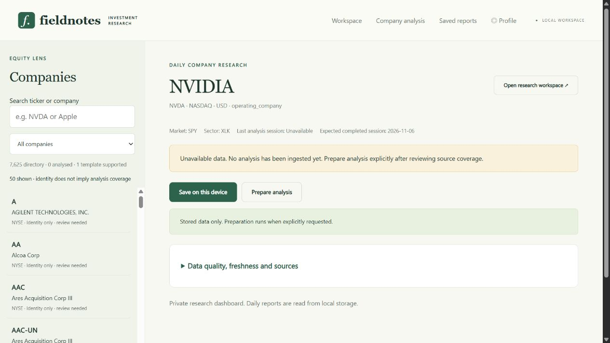
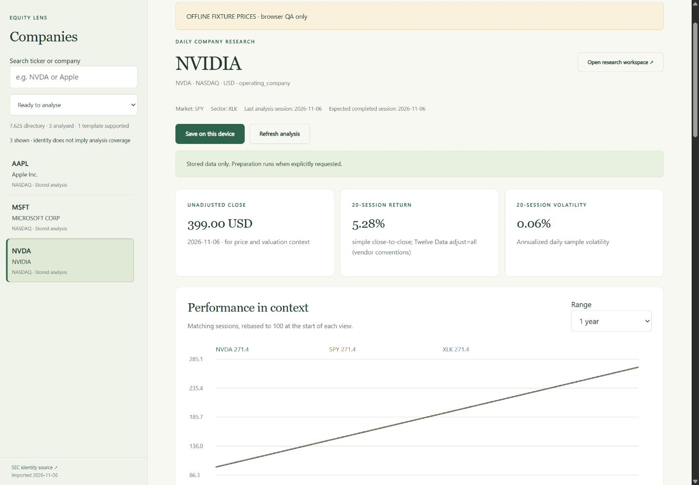
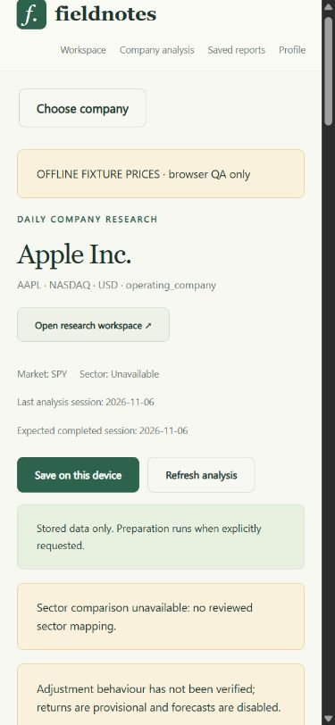

# Equity Lens multi-company browsing

Implemented on 6 November 2026 as an extension of the existing stored-company module.
The original [single-company analysis](single-company-analysis.md) and
[historical context engine](historical-context-engine.md) remain in the same app.

## Launch

From the project directory in PowerShell:

```powershell
.\.venv\Scripts\python.exe -m investment_assistant web --port 8001
```

Open [Company analysis](http://127.0.0.1:8001/company). Port 8001 was used for
acceptance because an existing process already occupied port 8000. The original
command without `--port` still defaults to 8000.

The real local database currently contains **7,625 candidate listings, zero stored
analyses, and one reviewed financial template**. No example prices were put in that
database. A verified SQLite backup was taken before migration at
`data/single-company/backups/before-multi-company-2026-11-06.sqlite3`.

## Repository audit and implementation map

The repository uses FastAPI, Jinja, browser JavaScript and SQLite. The existing pilot
was configurable through `CompanyConfig`, but snapshots, jobs, price keys and the
dashboard assumed a single selected ticker. The original model evaluation identity
already included the company and benchmarks. No repository `AGENTS.md` was found.
The workspace's `.git` directory is an empty OneDrive reparse directory; `git status`
reports that this is not a Git repository, so a Git diff is unavailable.

| Existing area | Additive implementation |
| --- | --- |
| `single_company/storage.py` | Migration 3, canonical key resolution, scoped ingestion jobs, coverage publication, consistent existing backups, web-lifetime WAL connection |
| `single_company/directory.py` and `reference/` | SEC seed, issuer/security identities, explicit provider mappings, atomic import validation, ranked local search and pagination |
| `single_company/facade.py` | SecurityContext adapter to stored reports and saved historical cases |
| `single_company/jobs.py` | Durable preparation/refresh/directory queue, atomic claims, leases, recovery and provider credits |
| `single_company/config.py`, `analysis.py`, `pipeline.py`, `providers.py`, `forecast.py` | Selected-security inputs, shared datasets, template/valuation restrictions, security-specific forecast identity and deferred quota handling |
| `single_company/web.py` | Directory, scoped report/price and protected queue routes; original API wrappers retained |
| `web/templates/company*.html`, `web/static/company.js`, `company.css` | Navigator, report fragment, existing historical cards, mobile drawer and selection controller |
| `web/app.py` | Close persistent readers on shutdown and retain an idle WAL connection while serving |
| `single_company/cli.py`, `scripts/run_company_job.ps1` | Directory import, reference verification, explicit queue commands and worker scheduling |
| `tests/test_multi_company.py`, `tests/serve_multi_company_fixture.py` | Offline integration contracts and labeled delayed-response browser fixtures |

## Identity and source coverage

The bundled [SEC exchange directory](https://www.sec.gov/files/company_tickers_exchange.json)
was retrieved on 6 November 2026. Its declared fields are parsed rather than assumed
to occupy fixed positions. `reference/sources.json` records the source and SHA-256.
The source contains 10,409 rows; supported US exchange candidates yield 7,625
navigator entries after keeping the existing SPY/XLK benchmarks separate.

This is a candidate directory, not a claim of complete tradable-security coverage,
data entitlement, sector classification or 7,625 prepared financial reports.
Imported rows start with unreviewed instrument/currency/template coverage. The
reviewed original NVDA pilot keeps its original configuration. Funds, foreign
issuers, REITs, banks and insurers do not inherit that industrial template.

Issuer identity is SEC CIK. Each listing/share class has a separate stable security
ID. IDs survive repeat imports; retired IDs and archived reports remain stored.
Changed active ticker/issuer mappings stop an import for review. A malformed,
duplicate or more-than-20% shrinking import rolls back entirely. Provider aliases
are stored explicitly and are searchable without punctuation substitution.

Verify additional price mappings from an account-permitted official Twelve Data
stock reference catalogue:

```powershell
.\.venv\Scripts\python.exe -m investment_assistant company reference-import C:\path\stocks.json
```

The importer matches exact symbol/exchange, USD currency and Common Stock type.
Unmatched entries remain discoverable with a review-needed badge. This grants
price-analysis readiness only; it does not grant account entitlement, a financial
template, a sector mapping or adjustment approval. Other symbol spellings require
an explicitly reviewed `provider_symbols` mapping. No global alias replacement or
sector inference from names occurs.

SEC directory imports can also be supplied locally:

```powershell
.\.venv\Scripts\python.exe -m investment_assistant company directory-import C:\path\company_tickers_exchange.json
.\.venv\Scripts\python.exe -m investment_assistant company directory-refresh
```

The latter enqueues a durable source refresh. The worker also queues a weekly
directory refresh when the last successful import is over seven days old and a
SEC contact is configured. It keeps the last good directory on failure.

## Storage, calculations and forecasts

Migration 3 retains the original identity table as `legacy_security_identities`,
extends `securities` into the listing directory, and adds issuers, mappings,
coverage, queue and credit tables. Archived NVDA reports are attributed to the
canonical pilot only after their ticker, CIK, exchange and currency match. Old
unattributed job history is not guessed into another company's scope.

Legacy NVDA/SPY/XLK physical price keys remain fixed storage aliases so archived
lineage and original CLI access continue working. New company prices use stable
security IDs. Snapshot fingerprints include the security ID and full report/input
versions. Snapshot lookup and new ingestion job status are security-scoped. SEC
facts/filings remain CIK-scoped; macro series and compatible benchmark data are
shared and reused. Snapshot publication and coverage updates are atomic.

The original NVDA return, volatility, beta, drawdown, financial calculations and
forecast thresholds were retained. Unknown sectors use SPY alone; sector series
and affected metrics remain null. Unreviewed financial templates withhold their
metrics. New securities also withhold share-based valuation until the share-class
mapping is reviewed. Missing values are never converted to zero.

NVDA's frozen evaluation identity is preserved. New company evaluation identities
include their canonical security ID. The current model requires a reviewed sector
benchmark; no-sector companies remain ineligible. NVDA adjustment review does not
transfer to another security. No new forecasting model or probability was added.

Saved historical evidence is read through `ContextArtifactStore` with the selected
active ticker and report cutoff. Existing market-only versus company-specific
scope and each case's scope notice remain visible. Missing company analogues are
explicitly unavailable. No historical news request runs during browsing.

## API and browser behavior

All directory, identity, report, price and health GET requests read stored data.
Selecting a company does not enqueue ingestion or schedule monitoring.

- `GET /api/securities?q=&filter=all|ready|saved&cursor=&limit=50`
- `GET /api/securities/{id}`
- `GET /api/securities/{id}/analysis/latest`
- `GET /api/securities/{id}/report` — escaped Jinja fragment in a security-ID envelope
- `GET /api/securities/{id}/prices?range=1y`
- `POST /api/securities/{id}/prepare` and `/refresh`
- `GET /api/analysis-jobs/{job_id}`

The original `/api/company`, `/api/prices`, `/api/analysis/latest` and `/api/health`
remain compatible. Existing loopback hosting, trusted hosts, same-origin CSRF,
escaping and CSP protections also cover the new mutation routes. Inputs and page
sizes are bounded; cursors are opaque and bound to the query/filter/saved set.
SQL ranking and sorting are fixed and parameterized.

Desktop uses a 304px sidebar with independent touch/keyboard scrolling. Rows select
only on explicit activation; changing focus or scrolling does not change reports.
Search text and list position survive selection. Results append in pages of 50
with an intersection sentinel and Load more fallback. Search order is exact ticker,
ticker prefix, name prefix and name substring, then stable ticker/exchange/ID ties.

Explicit URLs take precedence over device-local last selection, then NVDA. Unknown
and retired IDs show a resolution state. Back/Forward restore the selected company.
Saved pins are labeled as device-local. The mobile drawer traps focus, supports
Escape and closes on selection. Reduced motion and visible focus are supported.

Selection aborts old report/chart requests and increments a token. The controller
checks both token and response security ID before applying content, clears the old
report immediately, and shows a skeleton. A late job response can update its own
row badge without replacing another report. Polling is limited to the selected
job, backs off to 30 seconds, pauses when hidden, and stops on terminal states.

## Durable jobs and activation prerequisites

Preparation is explicit and duplicate active jobs coalesce. A separate worker
claims queued work atomically, renews leases during requests, recovers expired
claims after crashes and publishes through the existing serialized ingestion
pipeline. Network calls never occur inside a SQLite write transaction. Source
failures retain previously usable datasets and snapshots; safe errors omit keys
and provider response bodies.

Configure the existing credentials, descriptive SEC contact and reviewed usage
records before live ingestion. Set the new UTC daily request/credit budgets from
actual account permissions in `.env`:

```text
COMPANY_TWELVE_DAILY_CREDITS=0
COMPANY_SEC_DAILY_CREDITS=0
COMPANY_FRED_DAILY_CREDITS=0
```

Zero is intentionally the shipped default. Queued jobs wait rather than make
unbudgeted requests. Each attempted request/retry reserves provider credits
atomically; minute caps, request weights, 429 and Retry-After defer work with a
retry time. Waiting jobs are not repeatedly claimed before that time. The original
direct `company ingest` CLI retains its existing request caps and review gates.

```powershell
.\.venv\Scripts\python.exe -m investment_assistant company --security-id sec-0001045810-nvda prepare
.\.venv\Scripts\python.exe -m investment_assistant company worker --limit 5
```

An external scheduler may run `scripts/run_company_job.ps1 -Worker`, or:

```powershell
.\.venv\Scripts\python.exe -m investment_assistant company worker --limit 5 --scheduled
```

The opt-in `--scheduled` flag queues daily updates only for companies with a
successful stored preparation in the last seven days. Explicit requests outrank
these updates, which outrank directory refresh. Directory inclusion and transient
sidebar clicks never create daily coverage. The existing `-Scheduled` NVDA command
remains available. No system scheduler was registered by this change.

## Verification

The original reported 312-test count was not assumed to be current. An initial
attempt encountered Windows sandbox temporary-folder/loopback restrictions;
subsequent checks used the existing offline guard with loopback available.
The guard blocks external sockets, live market history and paid OpenAI calls.

- Full offline suite: **335 passed**, including the 314 retained tests and 21 new multi-company checks.
- Focused multi-company, original company and original web suites: **53 passed** after the reader/migration changes.
- Final scheduler/isolation and frozen-evaluation checks: **3 passed**.
- `python -m ruff check src tests scripts`: **All checks passed**.
- Two existing dependency warnings remain: AnyIO assertion rewriting and Starlette/httpx deprecation.

The full-suite command was `.venv/Scripts/python.exe tests/run_offline.py -q --basetemp C:/Users/hanxr/.codex/visualizations/2026/11/06/01a1b2c3-d6ab-7ea2-9d6b-d12bc35e4d7f/pytest-multi-final --tb=short`.

The real app was launched and checked on port 8001: correct counts, honest empty-data state, no fixture data, no horizontal overflow and no browser console errors.

The real database's pre-migration backup and post-migration integrity check both
passed. It had no archived analysis snapshots before this change. Offline fixtures
exercise report/forecast lineage and restore with populated databases instead.

Browser QA used a separate database and labeled fixture prices for NVDA, AAPL and
MSFT, with Apple report responses delayed by 500ms. Rapid switching ended with the
last selected company's heading, ID and prices. Back/Forward, Enter/arrow keys,
independent scrolling, preserved search, mobile selection, Escape/focus restoration
and a 390px layout with no horizontal overflow were checked. The actual local dashboard:



Fixture artifacts:





The final local service measurements used Windows 11 and Python 3.12.14 with 7,625
sourced records, while regression tests ran concurrently. Across 50 mixed queries,
search p95 was **70.61ms**, first query **50.4ms**. A persistent query-only SQLite
reader with a 16 MiB page cache removed the repeated cold-reader overhead. Across
30 fixture report reads, service p95 was **36.23ms**. These are local service
measurements, not claims about browser load time or production HTTP latency.

Live price ingestion, account entitlement checks, independent adjustment
reconciliation, new-company template/sector review and company-specific model
validation remain separate activation prerequisites. No live quotes, paid market
data integration or OpenAI requests were used to populate the dashboard.
